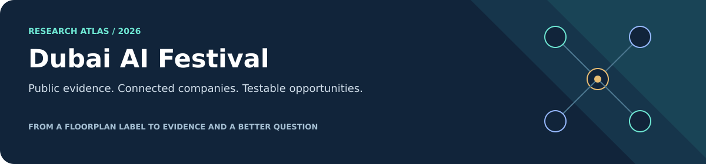

# Dubai AI Festival · Research Atlas

**English is the primary language.** [Русская версия](README.ru.md)

An independent, public-source research showcase: what selected exhibitors offer, where their capabilities connect, where they overlap, and which questions would turn a plausible idea into a testable next step. **Not an organizer publication, a partnership announcement or a qualified lead list.**

## Choose your starting point

| Your question | Start here | What you will find |
|---|---|---|
| 🧭 **What is the bigger picture?** | [Cross-company value chains](research/en/value-chains.md) | A connected view of products, business needs, integration paths and boundaries |
| 🏢 **What does this company actually do?** | [Company directory](research/en/README.md#company-directory) | Direct links to 18 selected company briefs and the original 12 evidence profiles |
| 🔗 **Which connections are documented?** | [Documented links and boundaries](research/en/value-chains.md#documented-links-and-their-limits) · [Original 14 edges](research/en/crossresearch.md) | Documented product links, proposed combinations and competitive overlap — kept distinct |
| 📋 **Who is on the public floorplan?** | [Complete candidate roster](research/en/roster.md) | All 248 candidate organization labels with stand assignments and combined research status |
| 🧪 **What could a real workflow look like?** | [Three reference workflows](research/en/value-chains.md#three-workflows-to-make-the-map-useful) | Operations, conversation-to-work and a connected-building incident — all explicitly hypothetical |
| 🗓️ **What is listed for the Startup Stage?** | [Public agenda supplement](research/en/startup-agenda.md) | Selected 26–27 October blocks, Dubai times and an unresolved morning-workshop discrepancy |
| 🔎 **Can I inspect the evidence?** | [Sources and claim policy](docs/en/source-policy.md) · [Data guide](data/README.md) | Source registers, claim boundaries, machine-readable files and reproducibility |

## The research, at a glance

| Layer | Coverage | What the number means |
|---|---:|---|
| Public floorplan snapshot | **264 rows · 262 labels** | Observed on 26 October 2026; repeated and non-company labels retained |
| Organization-candidate inventory | **248 labels** | A research universe, **not** a verified count of legal companies |
| Original structured baseline | **12 profiles · 14 typed edges** | 23 official sources and 37 source-linked facts; 236 candidates lack a baseline profile |
| Expanded value-chain study | **18 companies · 21 typed relationships** | 61 claim records, 38 official sources; the original 12 plus 6 additions; **230 candidates remain outside this study** |

Evidence counts are per study and overlap; do not add the two rows into a unique source or fact total.

The current roster combines both layers. Original data files preserve the **12-profile baseline**; the separate current-coverage register tracks all 18 covered companies and the remaining 230. [Coverage, definitions and remaining work →](docs/en/research-status.md)

## A map of roles, not a map of promises


The same company may span several roles. Categories are an editorial navigation aid, not mutually exclusive market segments. [Browse the role table and company briefs →](research/en/README.md#browse-by-role)

### Three questions worth carrying into a conversation

1. **What does “documented” mean here?** Atlan–Snowflake has technical connector instructions; Smart Spaces names Watergate on an integration-partner page. Both are useful evidence, but not the same depth of proof. [Inspect the documented links →](research/en/value-chains.md#documented-links-and-their-limits)
2. **Who owns access and execution?** Cortex Search's owner's-rights behavior and ClickUp's creator-linked webhook lifecycle turn permissions and offboarding into design questions, not footnotes. [Follow the governed-operations workflow →](research/en/value-chains.md#1-a-governed-operations-assistant)
3. **Partners in a workflow, or alternatives for the same job?** Compare Elastic/Snowflake, ElevenLabs/Haptik and PlaceOS/Smart Spaces before assuming they should all be combined. [Read the comparison questions →](research/en/value-chains.md#where-companies-complement-or-compete)

## How the work is built


**Documented facts → explicitly labelled interpretation → a validation question.** A public API does not establish integration readiness. A source-backed product link does not establish a commercial partnership. A booth label does not establish legal identity, attendance or buying interest.

## Inside the repository

| Section | Contents |
|---|---|
| [Research](research/README.md) | English and Russian reading routes, company index, value chains, baseline profiles and full roster |
| [Method and limitations](docs/README.md) | Scope, coverage, source standards, identity rules and reproducibility |
| [Data](data/README.md) | Public floorplan, normalized entities, original evidence graph and expanded research registers |
| [Validation scripts](scripts/README.md) | Local integrity checks and navigation / SVG checks |
| [Visual assets](assets/README.md) | Original, accessible, dependency-free SVG illustrations; no company logos |

### Reproduce the local checks

```sh
python scripts/validate_public_research.py
python scripts/validate_navigation.py
```

These checks verify local structure and links, **not** live web availability or the truth of every external claim. [Rebuild instructions and limits →](scripts/README.md)

---

**Public-only boundary.** No authenticated attendee directory, private biography, private contact details or account screenshots are included. Public vendor statements describe advertised capabilities, not independently verified results. No personal ranking or outreach is performed. The full authorized working dataset belongs only in the owner's separately verified private repository; it must not be imported into this tree. Research is incomplete and dated, not a claim of live event coverage.
