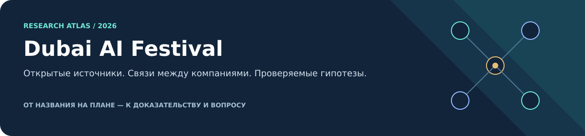
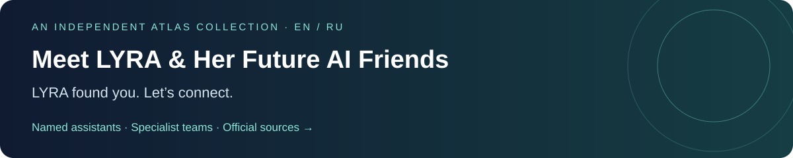
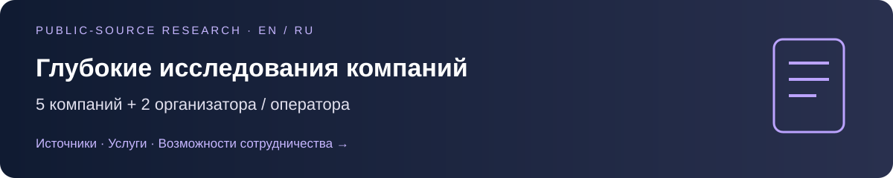

# Dubai AI Festival · Исследовательский атлас

[English — основной язык](README.md)

Независимое исследование на основе открытых источников: что предлагают выбранные экспоненты, как сочетаются их возможности, где есть пересечения и какие вопросы превращают идею в проверяемый следующий шаг. **Не публикация организатора, не анонс партнёрств и не список квалифицированных лидов.**


[](research/ai-friends/README.md)

**[Meet LYRA & Her Future AI Friends →](research/ai-friends/README.md)** · **[Лира и её будущие AI-друзья →](research/ai-friends/README.ru.md)**

Приватный персональный AI знакомится с именованными ассистентами, разговорными платформами и специализированными командами. Независимая подборка, не объявление о партнёрстве.

[](research/completed-deep-research/README.ru.md)

**[Глубокие исследования: готовые профили компаний →](research/completed-deep-research/README.ru.md)** · **[English →](research/completed-deep-research/README.md)**

**7 готовых исследований: 5 компаний + 2 организатора / оператора.** KB Financial Group · Kira AI · Integra Technologies · ImposterHunter · Planytics / VERA; отдельно — Dubai AI Campus и Terrapinn. Источники, услуги, ограничения и гипотезы сотрудничества. Исследования по открытым источникам, не независимые продуктовые аудиты.

## 🧭 Расширенный атлас фестиваля · 26 октября 2026

Начните с **новых справочников по открытым источникам**. Основной язык — английский; каждому маршруту соответствует русская версия. Новые разделы дополняют, а не заменяют исходное исследование 18 компаний.

| Раздел | Русский | English |
|---|---|---|
| 🏢 Компании, возможности и вопросы для сотрудничества | [Атлас компаний](research/company-atlas/README.ru.md) · [Матрица](research/company-atlas/matrix.ru.md) | [Companies](research/company-atlas/README.md) · [Matrix](research/company-atlas/matrix.en.md) |
| 🎤 Спикеры и заявленные темы сессий | [Атлас спикеров](research/speakers/README.ru.md) · [По компаниям](research/speakers/by-company.ru.md) | [Speakers](research/speakers/README.md) · [By company](research/speakers/by-company.md) |
| 🤝 Организаторы, спонсоры и официальные каналы связи | [Справочник](research/organizers-sponsors/README.ru.md) | [Partner directory](research/organizers-sponsors/README.md) |
| 🔎 Покрытие и ограничения всех уровней | [Покрытие атласа](docs/ru/atlas-coverage.md) | [Atlas coverage](docs/en/atlas-coverage.md) |

**Смотрите на статус, а не только на имя:** название на плане — не изученная компания; заявленная сессия — не подтверждённое выступление; идея сотрудничества — не существующее партнёрство. Личные карточки участников и заметки о встречах здесь не публикуются.

### Исходное исследование

Маршруты и числа ниже относятся к сохранённому **исследованию цепочек ценности 18 компаний**, а не к общему числу материалов нового атласа. Его источники, утверждения и типизированные связи сохранены.

## С чего начать

| Ваш вопрос | Куда перейти | Что внутри |
|---|---|---|
| 🧭 **Как устроена общая картина?** | [Цепочки ценности между компаниями](research/ru/value-chains.md) | Продукты, бизнес-задачи, способы интеграции и ограничения |
| 🏢 **Чем конкретно занимается компания?** | [Указатель компаний](research/ru/README.md#указатель-компаний) | Прямые ссылки на 18 выбранных компаний и 12 исходных профилей с доказательствами |
| 🔗 **Какие связи подтверждены источниками?** | [Документированные связи и границы](research/ru/value-chains.md#документированные-связи-и-их-границы) · [Исходные 14 связей](research/ru/crossresearch.md) | Продуктовые связи, возможные сочетания и конкурентные пересечения — раздельно |
| 📋 **Кто указан на публичном плане?** | [Полный список кандидатов](research/ru/roster.md) | Все 248 названий кандидатов-организаций, стенды и объединённый статус исследования |
| 🧪 **Как мог бы выглядеть рабочий процесс?** | [Три примера процессов](research/ru/value-chains.md#три-процесса-которые-делают-карту-полезной) | Операционный ассистент, превращение диалога в задачу и инцидент в здании — явно обозначенные гипотезы |
| 🗓️ **Что указано для Startup Stage?** | [Дополнение из публичной программы](research/ru/startup-agenda.md) | Выборочные блоки 26–27 октября, время Дубая и неразрешённое расхождение по утреннему мастер-классу |
| 🔎 **Где проверить доказательства?** | [Правила работы с источниками](docs/ru/source-policy.md) · [Путеводитель по данным](data/README.md) | Реестры источников, границы выводов, файлы данных и воспроизводимость |

## Покрытие исследования

| Уровень | Покрытие | Что означает число |
|---|---:|---|
| Снимок публичного плана | **264 строки · 262 названия** | Наблюдение от 26 октября 2026 года; повторы и служебные зоны сохранены |
| Каталог кандидатов-организаций | **248 названий** | Исследовательская база, **не** проверенное число юридических компаний |
| Исходная структурированная база | **12 профилей · 14 типизированных связей** | 23 официальных источника и 37 фактов со ссылками; у 236 кандидатов нет исходного профиля |
| Расширенное исследование цепочек ценности | **18 компаний · 21 типизированная связь** | 61 запись утверждений, 38 официальных источников; исходные 12 и ещё 6 компаний; **230 кандидатов остаются вне исследования** |

Числа доказательств относятся к каждой выборке и пересекаются; суммировать строки как уникальные источники или факты нельзя.

Текущий список объединяет оба уровня. Исходные файлы данных сохраняют **базу из 12 профилей**; отдельный реестр текущего покрытия учитывает все 18 исследованных компаний и оставшиеся 230. [Покрытие, определения и оставшаяся работа →](docs/ru/research-status.md)

## Russian AI Intelligence in Action


Независимое исследование: Vladimir Uzbek · Quantum Bow. Это оформление нашего проекта, а не знак одобрения организаторов, государства или спонсоров.

## Приватный архив — только общее число

По состоянию на **26 октября 2026 года** в приватном исследовательском репозитории владельца сохранена **частичная выгрузка из 14 787 уникальных карточек профилей участников**. Это разрешённое владельцем к публикации общее число карточек, а не полная перепись участников, подтверждённое присутствие на площадке, проверенные телефонные контакты или личные знакомства. **Сами профили и контактные данные намеренно не публикуются здесь.**

## Карта ролей, а не обещаний


Одна компания может выполнять несколько ролей. Группы помогают навигации: это не взаимоисключающие сегменты рынка. [Таблица ролей и профили компаний →](research/ru/README.md#навигация-по-ролям)

### Три вопроса для содержательного разговора

1. **Что здесь означает «документировано»?** Для Atlan–Snowflake есть техническая инструкция коннектора; Smart Spaces называет Watergate на странице интеграционного партнёра. Оба источника полезны, но глубина доказательств разная. [Разобрать документированные связи →](research/ru/value-chains.md#документированные-связи-и-их-границы)
2. **Кто отвечает за доступ и выполнение?** Поиск Cortex Search с правами владельца и привязка вебхуков ClickUp к создавшему их пользователю делают права и отключение учётных записей частью архитектуры, а не сноской. [Пройти сценарий операционного ассистента →](research/ru/value-chains.md#1-управляемый-операционный-ассистент)
3. **Участники одной цепочки или альтернативы для одной задачи?** Сравните Elastic/Snowflake, ElevenLabs/Haptik и PlaceOS/Smart Spaces, прежде чем объединять все продукты. [Прочитать вопросы для сравнения →](research/ru/value-chains.md#где-компании-дополняют-друг-друга-или-конкурируют)

## Как устроена работа


**Документированный факт → явно обозначенная интерпретация → вопрос для проверки.** Наличие API не доказывает готовность к интеграции. Продуктовая связь не подтверждает коммерческое партнёрство. Название на плане не доказывает юридическую идентичность, присутствие на мероприятии или покупательский интерес.

## Что находится в репозитории

| Раздел | Содержание |
|---|---|
| [Исследование](research/README.md) | Маршруты чтения EN/RU, указатель компаний, цепочки ценности, исходные профили и полный список |
| [Метод и ограничения](docs/README.md) | Объём, покрытие, стандарты источников, правила идентификации и воспроизводимость |
| [Данные](data/README.md) | Публичный план, нормализованные записи, исходный граф фактов и расширенные реестры |
| [Скрипты проверки](scripts/README.md) | Локальная проверка целостности, навигации и SVG |
| [Иллюстрации](assets/README.md) | Оригинальные доступные SVG без внешних зависимостей и логотипов компаний |

### Запуск локальных проверок

```sh
python scripts/validate_public_research.py
python scripts/validate_navigation.py
```

Проверки оценивают структуру файлов и ссылки, **не** текущую доступность сайтов или достоверность каждого внешнего утверждения. [Пересборка и ограничения →](scripts/README.md)

---

**Только публичные данные.** Здесь нет авторизованного каталога участников, непубличных биографий, частных контактных данных и скриншотов аккаунта. Заявления поставщиков описывают рекламируемые возможности, а не независимо проверенные результаты. Ранжирование людей и рассылка не выполняются. Полные авторизованные рабочие данные должны храниться только в отдельно проверенном приватном репозитории владельца; переносить их сюда нельзя. Исследование неполное и привязано к дате, а не к текущему состоянию мероприятия.
