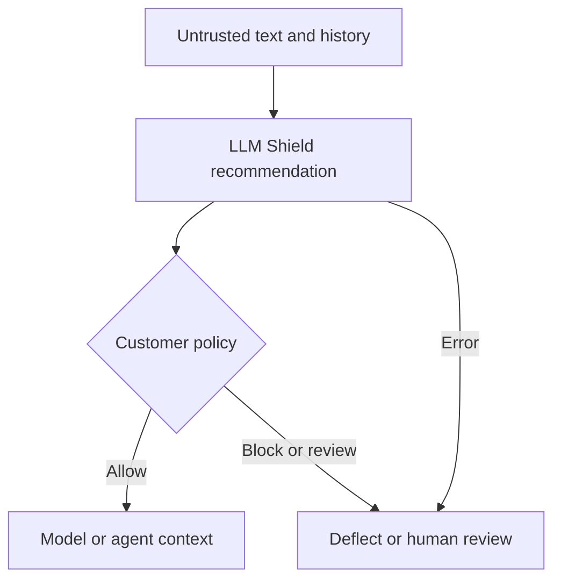

# ImposterHunter — LLM Shield and AI input security

[Русская версия](profile.ru.md) · [Short brief](brief.en.md) · [Sources](sources.json) · [Services](service-matrix.csv) · [Alternatives](competitor-matrix.csv)

Independent public atlas. Checked **26 October 2026 (Asia/Dubai)**. Extended desk research, including two product PDFs and the downloadable draft DPA; no account, evaluation key, operational API request or customer deployment was tested. **FACT** means a verified public disclosure, **VENDOR CLAIM** an untested supplier assertion, **INFERENCE** analysis, **PROPOSAL** a bounded hypothesis, **UNKNOWN** unresolved evidence. A source establishes what its publisher says; it does not independently validate delivery or effectiveness.

## A. Executive brief and identity

**FACT about public identity:** [imposterhunter.com](https://imposterhunter.com/) identifies **ImposterHunter AI LTD** as the contracting entity for customers worldwide: DIFC registration **13635**, commercial licence **CL13635**, registered office **Gate Avenue, South Zone, DIFC, Dubai, UAE**. This is a consistent vendor/legal disclosure, not an independently retrieved registry extract. The company page names **Dragos Balhui, Co-founder & CEO**, and **Cristina Balhui, Co-founder & Chief Threat Methodology Officer**. [IH02](https://imposterhunter.com/company) · [IH17](https://imposterhunter.com/terms)

**VENDOR CLAIM:** its flagship **LLM Shield** classifies text entering AI models and agents to detect prompt injection, jailbreaks and deception spread across conversations. The intended purchaser is an AI application owner or security team; engineers wire its recommendations into the application. This is an input security layer, with potential relevance to chatbots, agents, tools, retrieval, voice transcripts and memory. [IH01](https://imposterhunter.com/)

**FACT about the festival listing:** the atlas's dated extraction of the official embedded floorplan lists **Imposter Hunter, stand G113**, observed **26 October 2026, 03:30:39 UTC**. **UNKNOWN — sponsorship tier/category:** no matching placement was established on the public sponsor roster. A floorplan listing does not prove a sponsorship tier, legal identity, attendance or endorsement. [IH27](https://dubaiaifestival.com/floorplan/) · [IH28](https://floorplan.live/interactive/shows/4608/views/2/plan) · [IH26](https://dubaiaifestival.com/sponsors/)

Five decision facts:

1. The current catalog presents **six live surfaces on one API**, rather than six separately proven products. [IH03](https://imposterhunter.com/llm-shield)
2. A decision is a recommendation: the customer's application enforces its policy. [IH12](https://imposterhunter.com/resources/imposterhunter-llm-shield-prompt-injection-brief.pdf)
3. Hosted, VPC, on-premises and air-gapped deployments are advertised; delivered installations were not verified. [IH03](https://imposterhunter.com/llm-shield)
4. Current trust wording says **SOC 2 Type II preparation underway**, with target/auditor pending; ISO 27001 is planned for **2027**. [IH10](https://imposterhunter.com/trust)
5. Pricing is not published in the reviewed catalog; a technical demo, pilot terms and evaluation-key route are published. [IH18](https://imposterhunter.com/demo) · [IH11](https://imposterhunter.com/resources)

Five principal unknowns: independently reproduced effectiveness; full API limits and conversation semantics; contractual retention and complete subprocessor mapping; deployment sizing/operational support; commercial units, prices and SLA.

**Identity/version caution:** the October overview says founded **June 2026**, whereas the official company LinkedIn displays **2025** and lists Dubai/Bucharest. The company website currently emphasizes Dubai. Treat founding chronology and present Romanian operating structure as unresolved; do not infer a second contracting entity. [IH13](https://imposterhunter.com/resources/imposterhunter-best-defence-in-depth-ai-security-platform-overview.pdf) · [IH19](https://www.linkedin.com/company/imposterhunter)

## B. Products, services and availability

The following are **VENDOR CLAIMS**. They describe integration surfaces of the same classifier, not evidence of distinct underlying models, packaged connectors or separately priced SKUs.

| Surface | Buyer / operator; task | Published boundary and remaining question |
|---|---|---|
| LLM Prompt Shield | AI product/security lead / application engineer; screen chatbot and copilot input | Conversation-aware screening; obtain the actual multi-turn request format and history limits. [IH04](https://imposterhunter.com/llm-shield/prompts) |
| Voice Agent Shield | Contact-center technology owner / voice engineer; screen caller instructions | Operates on **transcribed text**, after speech recognition and before the agent reply; not acoustic fraud or speaker authentication. [IH05](https://imposterhunter.com/llm-shield/voice-agents) |
| AI Agent Shield | Agent platform owner / runtime engineer; guard successive context boundaries | Screens documents, tool outputs, recalled memory and agent messages; permissions and action approval remain separate controls. [IH06](https://imposterhunter.com/llm-shield/ai-agents) |
| MCP Shield | Integration/security owner / MCP client developer; inspect tool responses | Published wrapper serializes a returned response and classifies it; not documented as a complete MCP transport, identity or authorization firewall. [IH07](https://imposterhunter.com/llm-shield/mcp) |
| RAG Shield | Knowledge-platform owner / retrieval engineer; inspect retrieved chunks and ingested documents | Current page explicitly says **live**; parsing, OCR, supported file types and vector-store connectors remain unknown. [IH08](https://imposterhunter.com/llm-shield/rag) |
| Memory Shield | Agent owner / memory engineer; stop stored instructions being recalled as context | Recall screening is live; writes can be routed through the API. It explicitly **does not audit or clean an already poisoned store**. [IH09](https://imposterhunter.com/llm-shield/memory) |

**FACT about access:** the resources page links a two-page technical brief and eight-page overview. A guided **30-minute** demo accepts customer prompts/documents; its advertised outcome is pilot terms, NDA options and timeline. The technical brief offers a **free, time-boxed, revocable evaluation key** and says the full API reference accompanies it. No self-service account or production entitlement was verified. [IH11](https://imposterhunter.com/resources) · [IH18](https://imposterhunter.com/demo) · [IH12](https://imposterhunter.com/resources/imposterhunter-llm-shield-prompt-injection-brief.pdf)

**UNKNOWN:** per-request/token/seat pricing, minimum commitment, free quota, overage, private-deployment licence, support charges and implementation scope. Do not convert “free evaluation” into “free product.” Multilingual coverage is a detection claim, not proof of multilingual support staff or every locale's quality.

**Other offer requiring reconfirmation:** official LinkedIn describes **Social-Media Shield** for consent-based impersonation matching and takedown workflows, TikTok monitoring first, Instagram/YouTube next. The current website catalog and sitemap reviewed focus on LLM Shield. Current commercial availability, platform authorization and delivery evidence for the social-media offer are **UNKNOWN**; it is not treated as a delivered second business line. [IH19](https://www.linkedin.com/company/imposterhunter) · [IH25](https://imposterhunter.com/sitemap.xml)

## C. Business model and buying process

**INFERENCE:** this is a direct enterprise/API sale with an evaluation-to-pilot-to-expansion motion, plus potentially negotiated deployment/support work. The company explicitly says it is enrolling pilots. That does not reveal paying-customer count, revenue, contract size, margin or a mature self-service billing model. The observable buying route is a technical conversation with the builders. [IH02](https://imposterhunter.com/company) · [IH18](https://imposterhunter.com/demo)

**FACT:** general terms defer specific service levels to separately signed agreements and protect trade secrets. They restrict reverse engineering, using the service to train/evaluate/benchmark a competing product, and disclosing non-public technical information. A buyer's internal suitability evaluation and any publication rights therefore need an agreed scope; an invitation to bring examples is not unrestricted permission to publish comparative results. No service use occurred for this research. [IH17](https://imposterhunter.com/terms)

**PROPOSAL — procurement unit:** ask for a written quote covering requests at expected input/history lengths, concurrent calls, deployment, model updates, support and audit export. Compare total operating cost and blocked legitimate workflows, rather than just cost per classifier call. This is a purchase-assessment method, not a claim about the supplier's billing formula.

## D. Technical map and implementation responsibilities

**FACT about published interface:** current examples show a tenant-specific `https://<customer>.shield.imposterhunter.net/v1/analyze`, `X-API-Key`, JSON fields `input_text` and `context_type`. Demonstrated channel values include `prompt`, `mcp_tool`, `rag_document`, `voice_transcript` and `unknown`. These are documentation examples, not a verified production contract. [IH04](https://imposterhunter.com/llm-shield/prompts) · [IH06](https://imposterhunter.com/llm-shield/ai-agents)

**VENDOR CLAIM:** outputs include a risk score/level, action, category labels with confidence, evidence text and character offsets, `offset_confident`, `compound`, sanitized reasoning, an input hash and `turn_findings`. The overview calls example values illustrative and structure exact. The reasoning field is a published explanation; it is not evidence that internal model chain of thought is exposed. [IH03](https://imposterhunter.com/llm-shield)

**INFERENCE — enforcement:** a sound integration maps **PASS / LOG / FLAG / BLOCK** to explicit business behavior, including a review queue or deflection where appropriate. A `FLAG` handled as an unrestricted pass will not enforce the supplier's headline “non-PASS” detection statistic. The published Python and TypeScript snippets block on `BLOCK`; an implementer must define other actions and error handling rather than copy the sample as a complete policy. [IH04](https://imposterhunter.com/llm-shield/prompts) · [IH07](https://imposterhunter.com/llm-shield/mcp)

**VENDOR CLAIM — failure behavior:** the service returns an error, never a silent PASS. **INFERENCE:** this is fail-closed classification semantics; the surrounding application still needs to prevent an error, timeout or malformed response from bypassing screening. The website explicitly leaves application behavior to the customer. “Fail closed” does not establish automatic termination of all downstream tools, calls or sessions. [IH01](https://imposterhunter.com/)

**VENDOR CLAIM:** detection uses a proprietary model trained by the supplier and recognizes deception mechanisms across the conversation. Architecture, backbone, parameter count, weights, training corpus, update process and hardware requirements are **UNKNOWN**. The draft DPA's older description of an instruction-tuned LLM pipeline and LinkedIn's AWS Bedrock statement do not identify the current model or prove dependence on any particular foundation-model API. Request a current deployment/data-flow diagram. [IH14](https://imposterhunter.com/dpa) · [IH19](https://www.linkedin.com/company/imposterhunter)

**FACT about examples:** Python uses HTTP requests; TypeScript uses fetch alongside the MCP SDK. Headings saying “SDK” do not establish a separately distributed ImposterHunter package, version or support lifecycle. Native LangChain/LlamaIndex/telephony/vector-store connectors, webhooks, SAML/OIDC customer SSO, RBAC, SIEM export, bulk import/export and administrative APIs were not verified. OIDC-only **CI/CD** is a published deployment-pipeline control, not customer SSO. [IH06](https://imposterhunter.com/llm-shield/ai-agents) · [IH07](https://imposterhunter.com/llm-shield/mcp) · [IH10](https://imposterhunter.com/trust)

**UNKNOWN implementation gates:** history ownership and session identity; maximum bytes/tokens/turns; truncation and over-budget behavior; rate/concurrency limits; streaming and partial transcript handling; retry/idempotency; evidence offset encoding; score thresholds/calibration; version pinning and rollback; key lifecycle and tenant administration. Whole-conversation detection requires the integration to supply the necessary history; a single-text example alone does not prove server-side persistent conversation memory. These are questions, not demonstrated defects.

**VENDOR CLAIM — additional invariants:** the technical brief says a blocking verdict cannot be reversed by later persuasion, the same text receives the same recommended action across request shapes, and a fail-closed output gate suppresses internal identifiers. It distinguishes the turn where assessment changed from the turn containing quoted evidence. **UNKNOWN:** the state/session contract implementing those properties and their behavior when history is omitted, reordered or exceeds budget. Treat them as acceptance-test candidates, not independently proved invariants. [IH12](https://imposterhunter.com/resources/imposterhunter-llm-shield-prompt-injection-brief.pdf)

**Conceptual integration, not a verified implementation:** screening informs the customer's enforcement point. Tool permissions, output controls and human approvals remain separate.

## E. Buyers and bounded use cases

These scenarios are **INFERENCES**, not customer case studies. They follow the advertised surfaces. [IH01](https://imposterhunter.com/)

| Scenario | Decision-maker / champion | Success condition | Poor starting point |
|---|---|---|---|
| Employee knowledge assistant | CISO or AI owner / RAG engineer | Authorized corpus, chunk provenance, reviewed false positives and consistent screening | Assuming detection also enforces source access rights |
| Customer support copilot | Product/security lead / application owner | Legitimate instruction changes separated from suspicious redirection; escalation available | Automatic refusal without measuring customer friction |
| Tool-using enterprise agent | Platform lead / agent engineer | Every tool-return boundary covered; tool permissions and approvals separately constrained | Giving the agent broad permissions because a classifier is installed |
| Consented service call agent | Contact-center owner / voice engineer | Post-ASR screening, language/dialect set, deflection/handoff and latency budget agreed | Treating transcript inspection as voice identity/deepfake detection |
| Persistent-memory assistant | AI platform owner / memory engineer | Writes/recalls routed intentionally; source record and quarantine path retained | Expecting the shield to purge the durable store |

**PROPOSAL:** initial evaluation should use authorized, synthetic workflow records and benign look-alikes, with offline labels reviewed by the buyer. Measure classification and actual downstream action separately. Keep production data access and external actions outside the first assessment until the contract, data flow and policy are settled.

## F. Evidence: what the numbers establish

**VENDOR CLAIM, September 2026 live-API run:** the trust page reports **7,084 requests**, **1,700 attack samples**, **99.78% ROC AUC**, no attacks receiving PASS and zero errors during that run. Its stated false-positive rates are **0.86% ordinary production-shaped traffic** and **3.43% deliberately difficult benign look-alikes**. The page explicitly withholds the corpus, method and latency. These are supplier measurements, not a public independent benchmark. [IH10](https://imposterhunter.com/trust)

**FACT about metric interpretation:** ROC AUC concerns score separation; it is not 99.78% production accuracy, prevention probability or business loss reduction. The PDFs clarify that **99.59%** of attacks received **BLOCK**; the rest were flagged. The headline **100%** counts attacks not receiving PASS. Neither FLAG nor BLOCK by itself proves the downstream target model was successfully protected. [IH13](https://imposterhunter.com/resources/imposterhunter-best-defence-in-depth-ai-security-platform-overview.pdf)

**VENDOR CLAIM, separate run:** the technical brief's measured-results page is headed **2026-09-15, one build unchanged**. It claims **35+** supported languages but identifies **six tested**: English, French, Spanish, Chinese, Arabic and Russian. It reports **98.52%** multilingual accuracy, **100%** encoded-attack detection and zero false positives on that tested benign set; multilingual recall is **100%** for English/Chinese and **at least 95%** for the other four. Importantly, this was scored **directly on the engine**, not through the API, and is not pooled into the live-API figures. Sample counts and confidence intervals are not supplied. [IH12](https://imposterhunter.com/resources/imposterhunter-llm-shield-prompt-injection-brief.pdf)

**UNKNOWN:** held-out sampling, train/test overlap controls, class denominators behind each false-positive rate, policy thresholds, attack families/length distribution, independent reproduction, confidence intervals and workload throughput. Current pages do not substantiate the older cached latency figures; no numeric latency commitment is adopted here. Zero observed errors also cannot prove availability or failure behavior under every fault.

**FACT about case strength:** no named customer deployment with baseline, measured outcome and attributable reference was found in the reviewed public catalog/resources or targeted search. Illustrative attack examples are demonstrations, not incidents prevented for a client. NVIDIA Inception membership and the overview's AWS Activate portfolio claim describe ecosystem programs; neither is security certification, customer endorsement or a guarantee of detection quality. The overview's assertion that incumbents lack equivalent detection is not accepted as an objective market comparison. [IH11](https://imposterhunter.com/resources) · [IH13](https://imposterhunter.com/resources/imposterhunter-best-defence-in-depth-ai-security-platform-overview.pdf)

## G. Security, privacy and procurement blockers

**FACT about published assurance:** current trust status is preparatory SOC 2 work and planned ISO certification, not a completed report/certificate. “HIPAA-ready,” GDPR/CCPA controls, EU AI Act alignment and PCI-DSS scope under NDA are supplier positioning; no scoped independent assurance was inspected. The older draft DPA still mentions a Q4 2026 SOC 2 target, so request the current assurance pack and applicable signed commitments. [IH10](https://imposterhunter.com/trust) · [IH15](https://imposterhunter.com/dpa/imposterhunter-dpa-2026-05-draft.pdf)

**VENDOR CLAIM:** hosted data can be pinned to US or EU without cross-region replication absent opt-in. This does not establish UAE-local hosted inference. On-premises/air-gapped deployment is advertised but its telemetry, update and support flows need scoping. Encryption, API-key rotation, no customer-input training and a **30-day default deletion on termination** appear in the draft DPA summary; they are not verified controls or an executed agreement. [IH10](https://imposterhunter.com/trust) · [IH14](https://imposterhunter.com/dpa)

**FACT — legal artifact limit:** both the DPA webpage and its downloadable eight-page PDF say **draft v2026.05**, counsel review in progress, informational/non-binding. The downloaded PDF is itself a summary page rendering; it is not a countersigned agreement. It describes SCC modules 2/3, **10-business-day** DSAR assistance, **72-hour** breach notice and a signed DPA available by request. Require the actual executed document/TOM annex before relying on these provisions. [IH15](https://imposterhunter.com/dpa/imposterhunter-dpa-2026-05-draft.pdf)

**FACT — data-flow discrepancy:** trust lists **AWS and GA4**; privacy additionally lists **Calendly**; the DPA lists **AWS, Stripe, SendGrid/Twilio and Linear**. These may concern different data classes, stages or stale documents, but a complete current mapping was not established. The privacy page primarily explains website inquiries/analytics, not an exhaustive API prompt-retention schedule. [IH10](https://imposterhunter.com/trust) · [IH16](https://imposterhunter.com/privacy) · [IH14](https://imposterhunter.com/dpa)

**UNKNOWN / procurement gates:** request-level retention and logging, zero-retention availability, backups, evidence-span access/export, support access locations, human review, subprocessor change procedure, incident escalation, tenant isolation, deletion verification, key rotation and business continuity. Legal review should reconcile the complete data chain and order-specific liabilities; this profile makes no legal compliance determination.

## H. Competitors and build alternatives

The matrix compares **published scope**, not measured superiority. No cross-vendor test was run; separate vendor benchmarks are not comparable. Prices and buyer-specific terms are **UNKNOWN** unless confirmed in a quote.

| Alternative | Comparable layer / broader scope | Integration / deployment evidence | Decision limit |
|---|---|---|---|
| Check Point AI Guardrails / Lakera | Prompt attack screening; separate content/data controls | Official docs describe a detector and enforce-mode behavior, with claimed coverage over 100 languages/scripts | Verify present API package, data region and context behavior; published coverage is not equivalent accuracy. [IH21](https://docs.lakera.ai/docs/prompt-defense) |
| SentinelOne Prompt Security | Enterprise AI governance, leakage prevention, application/agent threats | Official platform page describes policy management and Singularity integration | Broader procurement scope; confirm standalone/runtime access, deployment and price. [IH22](https://www.sentinelone.com/platform/securing-ai-prompt/) |
| In-house Llama Prompt Guard 2 | Locally run malicious/benign classifier | Meta releases 86M/22M variants; model card documents a **512-token** context and segmentation guidance | Team owns hosting, history handling, thresholds, evidence and operations; licence review required. [IH20](https://huggingface.co/meta-llama/Llama-Prompt-Guard-2-86M) |
| In-house NVIDIA NeMo Guardrails | Programmable input/output/retrieval/execution policies | Configuration reference documents rail types and built-in checks; self-check depends on its chosen LLM | Framework rather than managed detection SLA; evaluate policy prompts and operating burden. [IH23](https://docs.nvidia.com/nemo/guardrails/configure-guardrails/configuration-reference) · [IH24](https://docs.nvidia.com/nemo/guardrails/configure-guardrails/guardrail-catalog/self-check) |
| Amazon Bedrock Guardrails | Managed prompt-attack filters; relevant festival alternative | AWS documents jailbreak/injection filtering, Standard-tier prompt leakage detection and input tagging | Check model/API integration, tier, language, region and price for the workload; no equivalent efficacy claimed. [IH29](https://docs.aws.amazon.com/bedrock/latest/userguide/guardrails-prompt-attack.html) |

**FACT:** AWS has an **AI Innovation Partner** placement on the official festival roster, providing an event-relevant alternative route. That role does not establish a partnership with ImposterHunter; the older AWS Bedrock dependency claim also does not prove Bedrock Guardrails is used inside LLM Shield. [IH26](https://dubaiaifestival.com/sponsors/) · [IH30](https://dubaiaifestival.com/wp-content/uploads/2026/10/aws_logo_2x.webp) · [IH19](https://www.linkedin.com/company/imposterhunter)

## I. Bounded improvement hypotheses

These are **PROPOSALS**, not findings that the product is broken. Existing multi-turn analysis, evidence spans, six surfaces, memory write routing and deployment choice should not be re-pitched as missing functionality.

1. **Observation:** public samples are deliberately short and full docs accompany evaluation access. **Question:** do buyer teams lose time translating the four actions and errors into business policy? **Improvement:** a reference policy adapter plus a synthetic contract fixture set. **Validation:** replay documented decision/error cases without external side effects. **Dependencies:** approved schemas, evaluation terms, buyer policy owner. **Success:** every defined outcome reaches its agreed route; errors never bypass inspection. [IH04](https://imposterhunter.com/llm-shield/prompts)
2. **Observation:** recall protection does not cleanse storage. **Question:** can operations reliably find/review the source record after a flag? **Improvement:** optional customer-side quarantine and provenance workflow, preserving audit/approval. **Validation:** synthetic recall/write records with reversible quarantine. **Dependencies:** store API, record identifiers and data-retention rules. **Success:** each flagged recall is traceable; approved recovery does not silently reintroduce quarantined text. [IH09](https://imposterhunter.com/llm-shield/memory)
3. **Observation:** six languages have a separate test, while support claims are wider. **Question:** does the buyer's dialect, code-switching and domain vocabulary affect friction? **Improvement:** permissioned, application-specific multilingual acceptance pack. **Validation:** blinded buyer labels and separate language cohorts. **Dependencies:** language reviewers and authorized evaluation scope. **Success:** agreed false-positive, recall and voice-turn delay budgets per cohort; report sample sizes rather than extrapolate worldwide. [IH12](https://imposterhunter.com/resources/imposterhunter-llm-shield-prompt-injection-brief.pdf)
4. **Observation:** legal/security disclosures span different lists and roadmap wording. **Question:** does this delay procurement? **Improvement:** a dated, module-specific data-flow/security packet. **Validation:** buyer security/legal review against one proposed deployment. **Dependencies:** vendor counsel and current architecture. **Success:** each data class has an owner, region, retention and processor, with signed exceptions explicit. [IH14](https://imposterhunter.com/dpa) · [IH16](https://imposterhunter.com/privacy)

## L. Markets and availability

**INFERENCE:** UAE AI application and enterprise security teams are a plausible initial audience because the supplier publicly contracts from DIFC. EU customers may value the advertised EU processing/private deployment choices. Neither geography establishes regulatory approval, a local support SLA or sector authorization. Obtain the processing and support arrangement for the exact workload. [IH02](https://imposterhunter.com/company) · [IH10](https://imposterhunter.com/trust)

**UNKNOWN:** country eligibility, sanctions/export screening, private-model distribution restrictions, billing currencies, public-sector procurement route and local-language support. Russian was included in the supplier's six-language test, but that establishes neither unrestricted sales to Russia nor lawful cross-border processing. Russian-speaking buyers elsewhere require the same entity, country, data and contractual checks. No bypass or unrestricted-market claim is proposed. [IH12](https://imposterhunter.com/resources/imposterhunter-llm-shield-prompt-injection-brief.pdf)

## M. Confirmed public business routes

| Route | Published purpose / appropriate use |
|---|---|
| [Demo form](https://imposterhunter.com/demo) | Technical demo, environment discussion, pilot/NDA/timeline; public routing, not a guaranteed decision-maker. [IH18](https://imposterhunter.com/demo) |
| office@imposterhunter.com | Company page labels press; demo page says replies come from this address. Use for relevant business routing, not assumed personal access. [IH02](https://imposterhunter.com/company) · [IH18](https://imposterhunter.com/demo) |
| security@imposterhunter.com | Vulnerability/security/privacy questions; not a sales decision-maker. [IH10](https://imposterhunter.com/trust) · [IH16](https://imposterhunter.com/privacy) |
| legal@imposterhunter.com | DPA request with company, jurisdiction and services in scope. [IH14](https://imposterhunter.com/dpa) |
| [Official LinkedIn](https://www.linkedin.com/company/imposterhunter) | Company updates and general public routing; founder roles are independently published on the company website. [IH19](https://www.linkedin.com/company/imposterhunter) |

No form, message or evaluation request was submitted. Founder-specific commercial fit, correspondence and outreach are outside this public profile.
