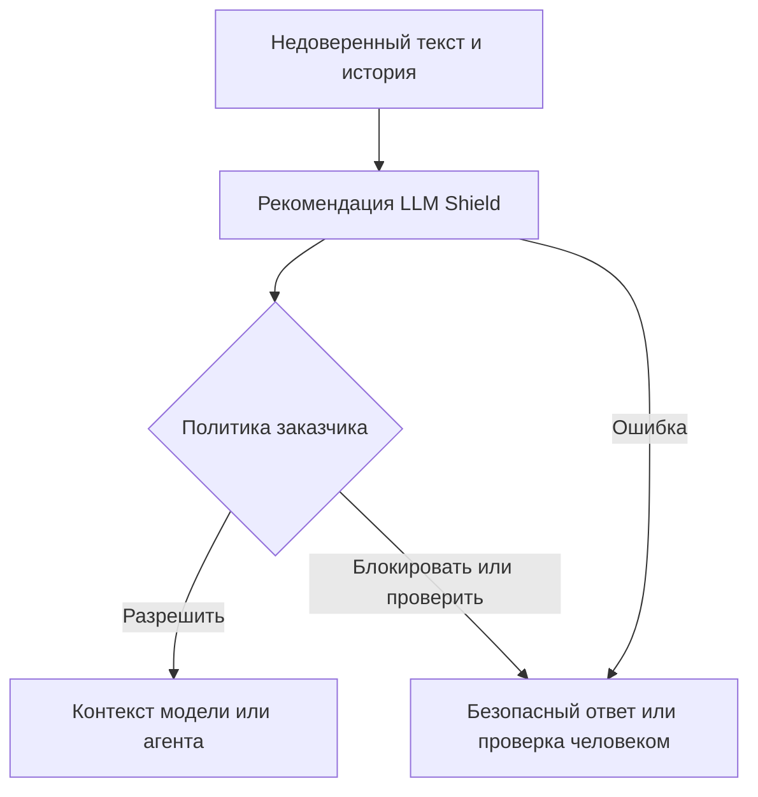

# ImposterHunter — LLM Shield и защита входящих данных ИИ

[English version](profile.en.md) · [Кратко](brief.ru.md) · [Источники](sources.json) · [Услуги](service-matrix.csv) · [Альтернативы](competitor-matrix.csv)

Независимый публичный атлас. Проверено **26 октября 2026 года, Asia/Dubai**. Расширенное исследование открытых публикаций, включая два продуктовых PDF и загружаемый проект DPA. Аккаунт, оценочный ключ, рабочий API и клиентское внедрение не проверялись. **FACT / ФАКТ** — проверенная публичная публикация; **VENDOR CLAIM / ЗАЯВЛЕНИЕ ВЕНДОРА** — непроверенное обещание поставщика; **INFERENCE / ВЫВОД** — аналитическая интерпретация; **PROPOSAL / ГИПОТЕЗА** — ограниченное предложение; **UNKNOWN / НЕИЗВЕСТНО** — неустранённый пробел. Источник подтверждает содержание публикации, но не является независимым доказательством работоспособности.

## A. Краткий вывод и идентификация

**ФАКТ о раскрытой идентичности:** [imposterhunter.com](https://imposterhunter.com/) называет **ImposterHunter AI LTD** стороной договора для клиентов по всему миру: регистрация DIFC **13635**, коммерческая лицензия **CL13635**, юридический адрес **Gate Avenue, South Zone, DIFC, Dubai, UAE**. Это согласованное раскрытие вендора и его юридических страниц, а не независимо полученная выписка из реестра. На странице компании указаны **Dragos Balhui, сооснователь и CEO**, и **Cristina Balhui, сооснователь и Chief Threat Methodology Officer**. [IH02](https://imposterhunter.com/company) · [IH17](https://imposterhunter.com/terms)

**ЗАЯВЛЕНИЕ ВЕНДОРА:** основной продукт **LLM Shield** классифицирует текст, поступающий в модели и агентов ИИ, чтобы обнаруживать prompt injection, jailbreak и обман, распределённый по разговору. Предполагаемый покупатель — владелец ИИ-приложения или служба безопасности; разработчик подключает рекомендации к политике приложения. Это входной защитный слой для чат-ботов, агентов, инструментов, retrieval, расшифровок звонков и памяти. [IH01](https://imposterhunter.com/)

**ФАКТ о фестивальном листинге:** датированная выгрузка атласа из официального встроенного плана содержит **Imposter Hunter, стенд G113**; время наблюдения — **26 октября 2026, 03:30:39 UTC**. **НЕИЗВЕСТНО — категория/уровень спонсорства:** соответствующее размещение в публичном списке спонсоров не установлено. Запись на плане не доказывает юридическую идентичность, уровень спонсорства, фактическое присутствие или одобрение организатором. [IH27](https://dubaiaifestival.com/floorplan/) · [IH28](https://floorplan.live/interactive/shows/4608/views/2/plan) · [IH26](https://dubaiaifestival.com/sponsors/)

Пять фактов для принятия решения:

1. Текущий каталог описывает **шесть действующих поверхностей одного API**, а не шесть независимо подтверждённых продуктов. [IH03](https://imposterhunter.com/llm-shield)
2. Решение API является рекомендацией; политику исполняет приложение заказчика. [IH12](https://imposterhunter.com/resources/imposterhunter-llm-shield-prompt-injection-brief.pdf)
3. Заявлены hosted API, VPC, on-premises и air-gapped; реальные поставленные инсталляции не проверены. [IH03](https://imposterhunter.com/llm-shield)
4. Текущий Trust Center указывает **подготовку к SOC 2 Type II**, без утверждённых срока/аудитора; ISO 27001 запланирован на **2027 год**. [IH10](https://imposterhunter.com/trust)
5. Цены в изученном каталоге не опубликованы; доступны маршруты к техническому демо, условиям пилота и оценочному ключу. [IH18](https://imposterhunter.com/demo) · [IH11](https://imposterhunter.com/resources)

Пять главных неизвестных: независимо воспроизведённая эффективность; полный API-контракт и семантика разговора; договорные сроки хранения и полный состав обработчиков; требования к развёртыванию/эксплуатации; цены, единицы тарификации и SLA.

**Оговорка об идентичности и версиях:** октябрьский обзор указывает основание в **июне 2026**, а официальный LinkedIn — **2025** и локации Dubai/Bucharest. Сайт сейчас делает акцент на Dubai. Хронология основания и текущая структура работы в Румынии требуют уточнения; второе юридическое лицо из этого не следует. [IH13](https://imposterhunter.com/resources/imposterhunter-best-defence-in-depth-ai-security-platform-overview.pdf) · [IH19](https://www.linkedin.com/company/imposterhunter)

## B. Продукты, услуги и доступность

Ниже — **ЗАЯВЛЕНИЯ ВЕНДОРА**. Речь об интеграционных поверхностях общего классификатора: наличие отдельных моделей, готовых коннекторов и самостоятельных тарифных SKU не доказано.

| Поверхность | Покупатель / пользователь; задача | Опубликованная граница и открытый вопрос |
|---|---|---|
| LLM Prompt Shield | Владелец ИИ-продукта или безопасности / разработчик; проверка сообщений чат-бота и copilot | Проверка с учётом разговора; нужны реальная схема многоходового запроса и лимиты истории. [IH04](https://imposterhunter.com/llm-shield/prompts) |
| Voice Agent Shield | Владелец технологий контакт-центра / voice engineer; проверка инструкций звонящего | Работает с **текстовой расшифровкой** после ASR и до ответа агента; это не акустический антифрод и не аутентификация диктора. [IH05](https://imposterhunter.com/llm-shield/voice-agents) |
| AI Agent Shield | Владелец агентной платформы / разработчик runtime; проверка границ контекста | Документы, результаты инструментов, извлечённая память и сообщения агентов; полномочия и согласование действий регулируются отдельно. [IH06](https://imposterhunter.com/llm-shield/ai-agents) |
| MCP Shield | Владелец интеграций/безопасности / разработчик MCP-клиента; проверка ответов инструментов | Пример сериализует полученный ответ и классифицирует его; полный firewall транспорта, идентификации и авторизации MCP не документирован. [IH07](https://imposterhunter.com/llm-shield/mcp) |
| RAG Shield | Владелец платформы знаний / retrieval engineer; проверка извлечённых фрагментов и поступающих документов | Текущая страница явно указывает **live**; парсинг, OCR, форматы файлов и коннекторы к vector store неизвестны. [IH08](https://imposterhunter.com/llm-shield/rag) |
| Memory Shield | Владелец агента / разработчик памяти; проверка сохранённых инструкций при возврате в контекст | Проверка recall доступна; записи можно направлять через API. Продукт прямо **не аудирует и не очищает уже отравленное хранилище**. [IH09](https://imposterhunter.com/llm-shield/memory) |

**ФАКТ о доступе:** Resources содержит двухстраничный technical brief и восьмистраничный overview. Предлагается **30-минутное** демо на запросах/документах заказчика; заявленный результат — условия пилота, варианты NDA и сроки. Technical brief предлагает **бесплатный, ограниченный по времени, отзываемый оценочный ключ**; полный API reference предоставляется с ключом. Самостоятельная регистрация и право production-доступа не проверены. [IH11](https://imposterhunter.com/resources) · [IH18](https://imposterhunter.com/demo) · [IH12](https://imposterhunter.com/resources/imposterhunter-llm-shield-prompt-injection-brief.pdf)

**НЕИЗВЕСТНО:** цена за запрос/токен/место, минимальный договор, бесплатная квота, превышение лимита, лицензия для частной инсталляции, поддержка и объём внедрения. Бесплатная оценка не означает бесплатный продукт. Многоязычность классификатора не подтверждает наличие службы поддержки на всех языках или одинаковое качество в любой локали.

**Дополнительное предложение требует подтверждения:** официальный LinkedIn описывает **Social-Media Shield**: поиск имперсонации с согласия пользователя, сопоставление профилей и процедуры takedown; сначала мониторинг TikTok, затем Instagram/YouTube. Изученные актуальные сайт и sitemap сосредоточены на LLM Shield. Коммерческая доступность, разрешения платформ и доказательства поставки social-media продукта **НЕИЗВЕСТНЫ**; считать его действующим вторым бизнесом нельзя. [IH19](https://www.linkedin.com/company/imposterhunter) · [IH25](https://imposterhunter.com/sitemap.xml)

## C. Бизнес-модель и закупка

**ВЫВОД:** наблюдается прямая корпоративная/API-продажа через оценку, пилот и расширение, возможно с отдельно согласуемыми работами по размещению и поддержке. Компания прямо сообщает о наборе пилотов. Из этого нельзя вывести количество платящих клиентов, выручку, средний контракт, маржу или зрелую самостоятельную биллинговую модель. Видимый путь к закупке — технический разговор с разработчиками. [IH02](https://imposterhunter.com/company) · [IH18](https://imposterhunter.com/demo)

**ФАКТ:** общие условия выносят SLA в отдельные подписанные соглашения и защищают коммерческую тайну. Запрещаются reverse engineering, использование сервиса для обучения/оценки/бенчмаркинга конкурирующего продукта и раскрытие непубличных технических сведений. Поэтому рамки внутренней проверки пригодности и права на публикацию результатов нужно согласовать: приглашение принести примеры не является безусловным разрешением публиковать сравнения. В этом исследовании сервис не использовался. [IH17](https://imposterhunter.com/terms)

**ГИПОТЕЗА — единица оценки закупки:** запросить письменный расчёт для ожидаемого числа запросов при нужной длине входа/истории, concurrency, размещении, обновлениях, поддержке и экспорте аудита. Сравнивать полную стоимость эксплуатации и число ошибочно остановленных легитимных сценариев. Это метод оценки, а не утверждение о фактической формуле биллинга поставщика.

## D. Техническая карта и ответственность интегратора

**ФАКТ об опубликованном интерфейсе:** актуальные примеры используют tenant-specific URL `https://<customer>.shield.imposterhunter.net/v1/analyze`, заголовок `X-API-Key`, JSON-поля `input_text` и `context_type`. Показаны значения канала `prompt`, `mcp_tool`, `rag_document`, `voice_transcript`, `unknown`. Это примеры документации, а не проверенный production-контракт. [IH04](https://imposterhunter.com/llm-shield/prompts) · [IH06](https://imposterhunter.com/llm-shield/ai-agents)

**ЗАЯВЛЕНИЕ ВЕНДОРА:** ответ содержит risk score/level, действие, категории с confidence, текст доказательства и символьные смещения, `offset_confident`, `compound`, очищенное объяснение, hash входа и `turn_findings`. Overview называет значения иллюстративными, а структуру точной. Опубликованное объяснение не доказывает раскрытие внутренней chain of thought модели. [IH03](https://imposterhunter.com/llm-shield)

**ВЫВОД об исполнении:** интеграция должна явно сопоставлять **PASS / LOG / FLAG / BLOCK** с бизнес-поведением, очередью проверки или безопасным завершением. Если `FLAG` всегда пропускать без ограничений, показатель обнаружения «всё, кроме PASS» не превращается в защиту процесса. Опубликованные Python/TypeScript-примеры останавливаются на `BLOCK`; остальные действия и ошибки необходимо определить отдельно, а не считать короткий snippet готовой политикой безопасности. [IH04](https://imposterhunter.com/llm-shield/prompts) · [IH07](https://imposterhunter.com/llm-shield/mcp)

**ЗАЯВЛЕНИЕ ВЕНДОРА о сбое:** сервис возвращает ошибку вместо скрытого PASS. **ВЫВОД:** это fail-closed-семантика классификатора; приложение обязано исключить обход проверки при timeout, некорректном ответе или исключении. Сайт прямо оставляет обработку заказчику. Формулировка fail closed не означает автоматическую остановку всех инструментов, звонков и сессий в инфраструктуре клиента. [IH01](https://imposterhunter.com/)

**ЗАЯВЛЕНИЕ ВЕНДОРА:** используется собственная обученная модель, определяющая механизм обмана в контексте разговора. Архитектура, backbone, число параметров, веса, обучающий корпус, процедура обновления и аппаратные требования **НЕИЗВЕСТНЫ**. Более старое описание instruction-tuned LLM pipeline в проекте DPA и упоминание AWS Bedrock в LinkedIn не идентифицируют нынешнюю модель и не доказывают зависимость от определённого API foundation-модели. Нужна актуальная схема развёртывания и движения данных. [IH14](https://imposterhunter.com/dpa) · [IH19](https://www.linkedin.com/company/imposterhunter)

**ФАКТ о примерах:** Python использует HTTP requests, TypeScript — fetch и MCP SDK. Заголовок «SDK» не подтверждает отдельный распространяемый пакет ImposterHunter, его версию или цикл поддержки. Готовые коннекторы LangChain/LlamaIndex/телефонии/vector store, webhooks, клиентский SAML/OIDC SSO, RBAC, SIEM-export, массовый импорт/экспорт и административные API не проверены. Опубликованный OIDC-only **CI/CD** относится к pipeline развёртывания, а не к SSO пользователей. [IH06](https://imposterhunter.com/llm-shield/ai-agents) · [IH07](https://imposterhunter.com/llm-shield/mcp) · [IH10](https://imposterhunter.com/trust)

**НЕИЗВЕСТНЫЕ условия интеграции:** кто хранит историю и идентификатор сессии; лимиты байтов/токенов/ходов; усечение и превышение бюджета; rate/concurrency limits; streaming и промежуточные ASR-результаты; retry/idempotency; система символьных смещений; пороги и калибровка; фиксация/откат версии; управление ключами и tenant. Для проверки всего разговора нужно передавать необходимую историю. Одно поле с текстом само по себе не доказывает существование постоянной серверной памяти диалога. Это вопросы к реализации, а не обнаруженные дефекты.

**ЗАЯВЛЕНИЕ ВЕНДОРА о дополнительных инвариантах:** technical brief говорит, что блокирующий verdict нельзя отменить дальнейшими уговорами, одинаковый текст даёт одинаковое действие при разных формах запроса, а fail-closed output gate не выпускает внутренние идентификаторы. Различаются ход изменения оценки и ход, откуда взята цитата. **НЕИЗВЕСТНО:** контракт состояния/сессии и поведение при пропущенной, переставленной или превышающей бюджет истории. Это кандидаты для acceptance tests, а не независимо доказанные свойства. [IH12](https://imposterhunter.com/resources/imposterhunter-llm-shield-prompt-injection-brief.pdf)

**Концептуальная интеграция, не проверенная реализация:** классификатор информирует политику заказчика; права инструментов, выходные ограничения и human approval задаются отдельно.

## E. Покупатели и ограниченные сценарии

Ниже — **ВЫВОДЫ**, а не клиентские кейсы; они следуют из заявленных поверхностей. [IH01](https://imposterhunter.com/)

| Сценарий | Decision-maker / champion | Условие успеха | Неудачная отправная точка |
|---|---|---|---|
| Внутренний помощник по знаниям | CISO или AI owner / RAG engineer | Разрешённый корпус, происхождение фрагментов, проверка false positives, все границы покрыты | Считать классификацию заменой прав доступа к источникам |
| Copilot клиентской поддержки | Product/security lead / application owner | Отделять допустимое изменение задачи от подозрительного перенаправления; доступна эскалация | Автоматические отказы без измерения неудобств для клиента |
| Корпоративный агент с инструментами | Platform lead / agent engineer | Проверяется каждый результат инструмента; права и подтверждения ограничены отдельно | Давать агенту широкие полномочия из-за наличия классификатора |
| Сервисный голосовой агент | Contact-center owner / voice engineer | Проверка после ASR, нужные языки/диалекты, handoff, бюджет задержки | Считать анализ транскрипта распознаванием deepfake или личности |
| Помощник с постоянной памятью | AI platform owner / memory engineer | Намеренная маршрутизация записи/recall; связь с исходной записью и карантин | Ожидать очистки постоянного хранилища средствами Shield |

**ГИПОТЕЗА:** начать с разрешённых синтетических рабочих записей и сложных доброкачественных примеров; labels предварительно проверяет заказчик. Отдельно измерять классификацию и фактическое downstream-действие. Доступ к production-данным и внешние действия не включать в первую оценку до согласования договора, движения данных и политики.

## F. Доказательства и смысл чисел

**ЗАЯВЛЕНИЕ ВЕНДОРА, live-API прогон за сентябрь 2026:** Trust Center сообщает **7 084 запроса**, **1 700 атакующих примеров**, **99,78% ROC AUC**, отсутствие PASS для атак и отсутствие ошибок в этом прогоне. False-positive rate указан отдельно: **0,86%** для обычного production-shaped трафика и **3,43%** для намеренно сложных доброкачественных примеров. Страница прямо говорит, что корпус, методика и latency не публикуются. Это измерение поставщика, а не независимый открытый benchmark. [IH10](https://imposterhunter.com/trust)

**ФАКТ об интерпретации:** ROC AUC отражает разделение score, а не точность production 99,78%, вероятность предотвращения атаки или снижение потерь. PDF уточняют: **99,59%** атак получили **BLOCK**, остальные — флаг. Заголовок **100%** считает все атаки без PASS. Самостоятельно ни FLAG, ни BLOCK не доказывает, что целевая модель и бизнес-процесс действительно были защищены. [IH13](https://imposterhunter.com/resources/imposterhunter-best-defence-in-depth-ai-security-platform-overview.pdf)

**ЗАЯВЛЕНИЕ ВЕНДОРА, отдельный прогон:** страница результатов technical brief озаглавлена **2026-09-15, одна неизменённая сборка**. Поддержка заявлена для **35+** языков, но протестированы **шесть**: английский, французский, испанский, китайский, арабский и русский. Указаны **98,52%** общей многоязычной accuracy, **100%** обнаружения кодированных атак и ноль false positives на проверенной доброкачественной выборке. Recall атак — **100%** для английского/китайского и **не ниже 95%** для остальных четырёх. Важно: оценка выполнена **на движке напрямую**, а не через API, и не объединяется с live-API показателями. Размеры выборок и доверительные интервалы не приведены. [IH12](https://imposterhunter.com/resources/imposterhunter-llm-shield-prompt-injection-brief.pdf)

**НЕИЗВЕСТНО:** процедура held-out sampling, контроль пересечения обучения и теста, знаменатели false-positive cohorts, пороги, семейства/длины атак, независимое воспроизведение, интервалы неопределённости и throughput. Актуальные страницы не подтверждают старые закэшированные значения задержки; числовое обещание latency здесь не принимается. Ноль наблюдавшихся ошибок не доказывает доступность сервиса или поведение при всех видах отказа.

**ФАКТ о силе кейсов:** в рассмотренных каталоге/ресурсах и целевом поиске не найдено названное клиентское внедрение с baseline, измеренным результатом и проверяемой рекомендацией. Примеры атак являются демонстрациями, а не доказательствами предотвращённого клиентского инцидента. NVIDIA Inception и заявленный в overview AWS Activate portfolio — экосистемные программы; это не сертификат безопасности, одобрение клиента или гарантия качества детектора. Утверждение overview об отсутствии аналога у incumbents не принимается как объективное сравнение рынка. [IH11](https://imposterhunter.com/resources) · [IH13](https://imposterhunter.com/resources/imposterhunter-best-defence-in-depth-ai-security-platform-overview.pdf)

## G. Безопасность, privacy и препятствия закупке

**ФАКТ о раскрытом assurance:** текущий Trust Center сообщает о подготовке к SOC 2 и планируемой ISO-сертификации, а не о готовом отчёте/сертификате. HIPAA-ready, GDPR/CCPA controls, EU AI Act alignment и PCI-DSS scope under NDA — формулировки поставщика; независимое подтверждение с областью действия не изучалось. Старый проект DPA всё ещё называет цель SOC 2 на Q4 2026; нужны текущий security pack и применимые подписанные обязательства. [IH10](https://imposterhunter.com/trust) · [IH15](https://imposterhunter.com/dpa/imposterhunter-dpa-2026-05-draft.pdf)

**ЗАЯВЛЕНИЕ ВЕНДОРА:** hosted-данные можно закрепить в US или EU, без межрегиональной репликации без opt-in. Это не подтверждает hosted inference внутри UAE. On-premises/air-gapped заявлены, но потоки telemetry, обновлений и поддержки нужно уточнить. Шифрование, ротация ключей, отсутствие обучения на входах клиента и **30-дневное удаление по умолчанию после прекращения договора** описаны в summary проекта DPA; это не проверенные контроли и не исполненный договор. [IH10](https://imposterhunter.com/trust) · [IH14](https://imposterhunter.com/dpa)

**ФАКТ об ограничении юридического артефакта:** и веб-страница DPA, и загружаемый восьмистраничный PDF помечены **draft v2026.05**, counsel review in progress, informational/non-binding. Скачиваемый PDF сам представляет summary страницы, а не подписанное соглашение. Описаны SCC modules 2/3, **10 рабочих дней** на DSAR assistance, **72 часа** на уведомление об утечке и получение подписанного DPA по запросу. До опоры на эти положения нужны исполненный документ и TOM annex. [IH15](https://imposterhunter.com/dpa/imposterhunter-dpa-2026-05-draft.pdf)

**ФАКТ о несовпадении карт данных:** Trust перечисляет **AWS и GA4**; privacy добавляет **Calendly**; DPA называет **AWS, Stripe, SendGrid/Twilio и Linear**. Возможно, речь о разных данных, стадиях продукта или устаревших документах; полная актуальная карта не установлена. Privacy в основном объясняет запросы с сайта и analytics, а не исчерпывающий режим хранения API-промптов. [IH10](https://imposterhunter.com/trust) · [IH16](https://imposterhunter.com/privacy) · [IH14](https://imposterhunter.com/dpa)

**НЕИЗВЕСТНО / условия закупки:** сроки хранения запросов и логов, zero-retention, backup, доступ/экспорт evidence spans, местонахождение сотрудников поддержки, human review, уведомление о новых обработчиках, escalation при инциденте, tenant isolation, подтверждение удаления, ротация ключей и continuity. Юристу следует согласовать полную цепочку и ответственность по конкретному заказу. Этот профиль не даёт юридического заключения о compliance.

## H. Конкуренты и самостоятельная сборка

Матрица сравнивает **опубликованный scope**, а не измеренное превосходство. Межвендорный тест не проводился; отдельные собственные benchmarks несопоставимы. Цены и индивидуальные условия — **НЕИЗВЕСТНО** до получения предложения.

| Альтернатива | Сопоставимый / более широкий слой | Доказательство интеграции/размещения | Ограничение решения |
|---|---|---|---|
| Check Point AI Guardrails / Lakera | Детекция prompt attacks; отдельные контроли контента/данных | Официальные docs описывают detector и Enforce mode; заявлены 100+ языков/письменностей | Проверить текущий API-пакет, регион и работу с контекстом; покрытие не равно одинаковой accuracy. [IH21](https://docs.lakera.ai/docs/prompt-defense) |
| SentinelOne Prompt Security | Корпоративный AI governance, leakage prevention, защита приложений/агентов | Официальная страница описывает политики и интеграцию Singularity | Более широкий предмет закупки; подтвердить standalone/runtime-доступ, размещение и цену. [IH22](https://www.sentinelone.com/platform/securing-ai-prompt/) |
| Llama Prompt Guard 2 внутри компании | Локальный классификатор malicious/benign | Meta публикует варианты 86M/22M; model card описывает окно **512 токенов** и сегментацию | Команда отвечает за hosting, историю, пороги, evidence и эксплуатацию; нужна проверка лицензии. [IH20](https://huggingface.co/meta-llama/Llama-Prompt-Guard-2-86M) |
| NVIDIA NeMo Guardrails внутри компании | Программируемые input/output/retrieval/execution policies | Reference описывает типы rails и готовые проверки; self-check зависит от выбранной LLM | Это framework, а не SLA управляемой детекции; оценить prompts и операционные затраты. [IH23](https://docs.nvidia.com/nemo/guardrails/configure-guardrails/configuration-reference) · [IH24](https://docs.nvidia.com/nemo/guardrails/configure-guardrails/guardrail-catalog/self-check) |
| Amazon Bedrock Guardrails | Управляемые фильтры prompt attacks; фестивальная альтернатива | AWS документирует jailbreak/injection filters, prompt leakage в Standard tier и input tagging | Проверить API/model integration, tier, язык, регион и цену; равная эффективность не заявляется. [IH29](https://docs.aws.amazon.com/bedrock/latest/userguide/guardrails-prompt-attack.html) |

**ФАКТ:** официальный список даёт AWS роль **AI Innovation Partner**, поэтому эта альтернатива релевантна мероприятию. Это не доказывает партнёрство с ImposterHunter; старое упоминание AWS Bedrock также не доказывает использование Bedrock Guardrails внутри LLM Shield. [IH26](https://dubaiaifestival.com/sponsors/) · [IH30](https://dubaiaifestival.com/wp-content/uploads/2026/10/aws_logo_2x.webp) · [IH19](https://www.linkedin.com/company/imposterhunter)

## I. Ограниченные гипотезы улучшения

Это **ГИПОТЕЗЫ**, а не утверждения о поломке продукта. Multi-turn analysis, evidence spans, шесть поверхностей, маршрутизация записи памяти и выбор deployment уже заявлены; их не следует предлагать как отсутствующие функции.

1. **Наблюдение:** публичные snippets короткие, полные docs выдаются с оценочным доступом. **Проверяемый вопрос:** тратят ли покупатели лишнее время на сопоставление четырёх действий и ошибок с политикой? **Улучшение:** reference policy adapter и набор синтетических contract fixtures. **Проверка:** воспроизведение решений/ошибок без внешних действий. **Зависимости:** утверждённые схемы, evaluation terms, владелец политики. **Успех:** каждый исход попадает в согласованный маршрут; ошибки не обходят проверку. [IH04](https://imposterhunter.com/llm-shield/prompts)
2. **Наблюдение:** recall-защита не очищает хранилище. **Вопрос:** могут ли операторы найти и проверить исходную запись после флага? **Улучшение:** необязательный клиентский workflow карантина и provenance с аудитом/согласованием. **Проверка:** синтетические записи/recall и обратимый карантин. **Зависимости:** API хранилища, идентификаторы, retention. **Успех:** каждый flagged recall связан с источником; восстановление не возвращает карантинный текст незаметно. [IH09](https://imposterhunter.com/llm-shield/memory)
3. **Наблюдение:** отдельно проверены шесть языков, заявлен более широкий охват. **Вопрос:** влияют ли диалект, code-switching и терминология покупателя на false positives? **Улучшение:** разрешённый многоязычный acceptance pack для приложения. **Проверка:** слепые labels покупателя и отдельные языковые cohorts. **Зависимости:** reviewers и согласованная область оценки. **Успех:** согласованные бюджеты false positives, recall и задержки голосового хода; явные размеры выборок без всемирной экстраполяции. [IH12](https://imposterhunter.com/resources/imposterhunter-llm-shield-prompt-injection-brief.pdf)
4. **Наблюдение:** security/legal описывают разные списки и этапы roadmap. **Вопрос:** задерживает ли это procurement? **Улучшение:** датированный data-flow/security pack по модулям. **Проверка:** review юристами и security покупателя для одного deployment. **Зависимости:** юрист и актуальная архитектура вендора. **Успех:** у каждого класса данных есть владелец, регион, retention и processor; исключения явно подписаны. [IH14](https://imposterhunter.com/dpa) · [IH16](https://imposterhunter.com/privacy)

## L. Рынки и ограничения доступности

**ВЫВОД:** UAE-команды ИИ-приложений и enterprise security — правдоподобная исходная аудитория, поскольку поставщик публично заключает договоры из DIFC. Для EU могут быть ценны заявленные EU processing и private deployment. География не означает регуляторное одобрение, локальный SLA поддержки или отраслевое разрешение. Нужны условия обработки и поддержки конкретного workload. [IH02](https://imposterhunter.com/company) · [IH10](https://imposterhunter.com/trust)

**НЕИЗВЕСТНО:** доступные страны, sanctions/export screening, ограничения распространения private model, валюты оплаты, государственный procurement и языки поддержки. Русский включён в шестиязычный тест поставщика; это не подтверждает неограниченные продажи в Россию или допустимость трансграничной обработки. Для русскоязычных покупателей в других странах нужны те же проверки контрагента, страны, данных и договора. Способы обхода ограничений не предлагаются. [IH12](https://imposterhunter.com/resources/imposterhunter-llm-shield-prompt-injection-brief.pdf)

## M. Подтверждённые публичные business routes

| Маршрут | Опубликованное назначение / уместное использование |
|---|---|
| [Форма демо](https://imposterhunter.com/demo) | Техническая демонстрация, архитектура, pilot/NDA/timeline; публичная маршрутизация, не гарантированный decision-maker. [IH18](https://imposterhunter.com/demo) |
| office@imposterhunter.com | Компания обозначает press; demo говорит, что ответы приходят с этого адреса. Подходит для релевантного делового routing, не означает личного доступа. [IH02](https://imposterhunter.com/company) · [IH18](https://imposterhunter.com/demo) |
| security@imposterhunter.com | Уязвимости, security/privacy; не sales decision-maker. [IH10](https://imposterhunter.com/trust) · [IH16](https://imposterhunter.com/privacy) |
| legal@imposterhunter.com | Запрос DPA с указанием компании, юрисдикции и услуг. [IH14](https://imposterhunter.com/dpa) |
| [Официальный LinkedIn](https://www.linkedin.com/company/imposterhunter) | Публичные обновления и общий маршрут; роли основателей отдельно опубликованы на сайте. [IH19](https://www.linkedin.com/company/imposterhunter) |

Формы, сообщения и запросы evaluation не отправлялись. Персональный коммерческий fit, переписка и outreach остаются за рамками публичного профиля.
