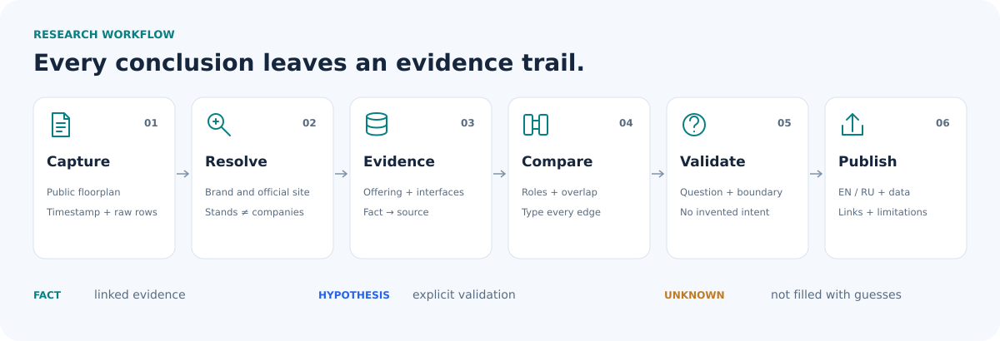

# Sources, claims and interpretation

[Home](../../README.md) · [Coverage](research-status.md) · [Русский](../ru/source-policy.md)

**The useful output is not just a conclusion. It is a conclusion with evidence, a boundary and a way to test it.**

## 1. Keep the input public

Use publicly accessible organizer pages, floorplans, official company sites, product documentation, integration catalogs and public case studies. Preserve the access date and the source URL. This repository does not use authenticated attendee data, private biographies, private contacts or account screenshots.

The [floorplan capture](../../data/floorplan-source-2026-10-26.json) establishes public labels and stand assignments. It does not establish identity, attendance, budget or interest. [Detailed normalization rules](public-baseline.md) preserve duplicates, shared stands, amenities and unresolved labels instead of manufacturing a clean company count.

## 2. Resolve before interpreting

- Start from the **exact public label**, not a guessed company domain.
- Distinguish a brand, product, institution, collective exhibit and legal entity.
- Use name-level deduplication only when justified; do not merge companies because they share a stand.
- Preserve uncertainty. A co-branded label or possible placeholder stays unresolved until evidence supports a change.
- Record the reason a public company site was matched to the label. A brand-site match is not legal-exhibitor verification.

## 3. Label the strength and type of every claim

| Claim type | What can be said | What must not be inferred |
|---|---|---|
| Public event evidence | “The captured plan lists this label at this stand.” | Physical presence, organizer endorsement, verified legal entity |
| Official offering evidence | “The vendor advertises or documents this capability.” | Independent performance, implementation success, universal availability |
| Named connector / integration | “This source documents this specific product connection.” | Every version, deployment region or use case is supported |
| Named alliance / partner statement | “The vendor names this organization as an alliance or integration partner.” | Verified contract terms, implementation success, deployment scope or a specific technical connector |
| Ecosystem listing | “This company or product appears in the vendor's ecosystem.” | A specific connector, certification, bilateral agreement or new commercial opportunity |
| Public case study | “The publisher reports this customer use case.” | Independently audited outcome or transferable ROI |
| Analyst hypothesis | “These capabilities could be tested together under these conditions.” | Partnership, readiness, willingness, procurement interest or proven value |
| Competitive overlap | “These offerings address part of a similar problem.” | Full substitutability, equal quality, equal pricing or equivalent coverage |
| Unknown | “Not established by the reviewed evidence.” | A confident answer filled in from plausibility |

A specific documentation page normally supports a narrower and stronger technical statement than a general marketing page. If sources disagree or differ in date, retain the distinction and describe the unresolved question; do not silently combine incompatible claims.

## 4. Make the evidence traceable

A reusable record should connect **company → claim → source → review date → limitation**. A cross-company edge additionally needs its **relationship type, supporting company facts and a validation question**.

- [Original source register](../../data/sources.json): source IDs, titles, URLs, access dates, retrieval method and evidence locators.
- [Original profiles](../../data/company-profiles.json): bilingual facts and explicitly unvalidated hypotheses.
- [Original typed graph](../../data/crossresearch.json): supporting facts, source URLs, validation questions and boundaries.
- [Expanded study registers](../../data/value-chain/README.md): company analysis, evidence and relationships for the expanded 18-company study.

Do not count links as independent confirmations merely because they appear in different reports. Prefer direct primary evidence and concise paraphrases; quote only the minimal wording needed to establish a claim.

## 5. Turn a proposed connection into a test

Before calling a combination viable, ask:

1. **Outcome:** what concrete user task should succeed, and what would count as failure?
2. **Surface:** which documented API, connector, endpoint or workflow is involved?
3. **Authority:** whose identity and permissions apply to each read or write?
4. **Data:** what can leave the system, where is it processed, and how fresh must it be?
5. **Operations:** who owns retries, duplicate prevention, monitoring, handoff and support?
6. **Proof:** what small sandbox demonstration and acceptance tests could disconfirm the hypothesis?
7. **Interest:** have the relevant parties actually confirmed willingness to participate?

For connected buildings, physical-control actions need an additional safety boundary. A read-only view or booking request is not equivalent to authority over locks, access systems, HVAC or water control.

## 6. Publish with the gaps visible

English is primary; Russian preserves the same factual meaning and caveats. Visual role maps are editorial indexes, not evidence of relationships. Icons and colors never replace written status labels. Original company names remain searchable in text.

Keep current coverage separate from historical batches. Never turn an integrity check into a claim that the web has been freshly verified. [Current scope](research-status.md) · [Baseline method](public-baseline.md) · [Reproduction and validation](../../scripts/README.md)

This is the method documented for this repository. Reusable research principles do not make different event datasets equivalent.
