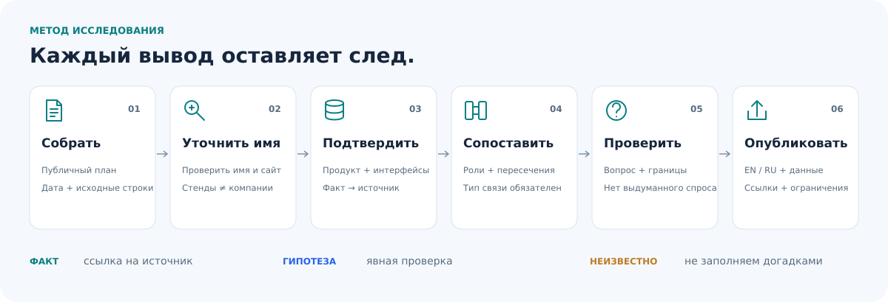

# Источники, утверждения и интерпретации

[Главная](../../README.ru.md) · [Покрытие](research-status.md) · [English](../en/source-policy.md)

**Результат — не просто вывод, а вывод с доказательством, границей применимости и способом проверки.**

## 1. Использовать только открытые материалы

Подходят публичные страницы организатора, планы, официальные сайты компаний, документация, каталоги интеграций и открытые кейсы. Сохраняются дата доступа и URL. В репозитории нет авторизованных данных участников, непубличных биографий, частных контактов и скриншотов аккаунта.

[Снимок плана](../../data/floorplan-source-2026-10-26.json) подтверждает публичные названия и стенды, а не идентичность, присутствие, бюджет или интерес. [Правила нормализации](public-baseline.md) сохраняют повторы, общие стенды, служебные зоны и неразрешённые названия, а не создают искусственно «чистое» число компаний.

## 2. Сначала установить идентичность

- Начинать с **точного названия на плане**, а не с угаданного домена.
- Различать бренд, продукт, учреждение, коллективную экспозицию и юридическое лицо.
- Объединять записи по названию только при наличии оснований; общий стенд не означает одну компанию.
- Сохранять неопределённость: составное название или возможный заполнитель остаётся неразрешённым до появления доказательств.
- Указывать основание сопоставления с официальным сайтом. Сайт бренда не подтверждает юридическую идентичность экспонента.

## 3. Обозначать тип и силу каждого утверждения

| Тип утверждения | Что можно сказать | Чего нельзя выводить |
|---|---|---|
| Публичное свидетельство о мероприятии | «На снимке плана это название указано у этого стенда». | Фактическое присутствие, рекомендация организатора, проверенное юридическое лицо |
| Официальное описание продукта | «Поставщик рекламирует или документирует эту возможность». | Независимо проверенные результаты, успешное внедрение, доступность везде |
| Названный коннектор / интеграция | «Источник описывает именно это продуктовое соединение». | Поддержка всех версий, регионов и сценариев |
| Названный альянс / заявление о партнёре | «Поставщик называет организацию участником альянса или интеграционным партнёром». | Проверенные условия договора, успешное внедрение, охват развёртывания или конкретный технический коннектор |
| Запись в экосистеме | «Компания или продукт присутствует в каталоге поставщика». | Конкретный коннектор, сертификация, двусторонний договор или новая коммерческая возможность |
| Публичный кейс | «Издатель сообщает об этом клиентском сценарии». | Независимый аудит результата или воспроизводимая окупаемость |
| Аналитическая гипотеза | «Эти возможности можно проверить вместе при таких условиях». | Партнёрство, готовность, желание участвовать, закупочный интерес или доказанная ценность |
| Конкурентное пересечение | «Продукты решают часть сходной задачи». | Полная взаимозаменяемость, равное качество, цена или покрытие |
| Неизвестное | «Рассмотренные источники этого не устанавливают». | Уверенный ответ, заполненный правдоподобной догадкой |

Конкретная страница документации обычно позволяет сделать более узкое и сильное техническое утверждение, чем общая маркетинговая страница. При расхождении источников или дат нужно сохранить различие и описать вопрос, а не незаметно объединять несовместимые утверждения.

## 4. Сохранять проверяемый путь к источнику

Полезная запись связывает **компанию → утверждение → источник → дату проверки → ограничение**. Для связи между компаниями дополнительно нужны **тип отношения, факты о каждой стороне и вопрос для проверки**.

- [Исходный реестр источников](../../data/sources.json): ID, названия, URL, даты доступа, способ получения и указатели на фрагменты.
- [Исходные профили](../../data/company-profiles.json): двуязычные факты и явно непроверенные гипотезы.
- [Исходный типизированный граф](../../data/crossresearch.json): опорные факты, URL, вопросы и границы.
- [Реестры расширенного исследования](../../data/value-chain/README.md): компании, доказательства и связи для выборки из 18 компаний.

Ссылка, повторённая в нескольких отчётах, не становится несколькими независимыми подтверждениями. Предпочтительны прямые первичные источники и краткий пересказ; цитируется только минимально необходимый текст.

## 5. Превращать предложенную связь в проверку

Прежде чем считать комбинацию работоспособной, нужно спросить:

1. **Результат:** какая конкретная задача пользователя должна выполняться и что считается неудачей?
2. **Интерфейс:** какой документированный API, коннектор, endpoint или процесс используется?
3. **Полномочия:** чьи идентичность и права действуют для каждого чтения и изменения?
4. **Данные:** что может покидать систему, где обрабатывается и насколько должно быть актуально?
5. **Эксплуатация:** кто отвечает за повторы, отсутствие дублей, мониторинг, передачу человеку и поддержку?
6. **Доказательство:** какая небольшая демонстрация в тестовой среде и какие приёмочные тесты могут опровергнуть гипотезу?
7. **Интерес:** подтвердили ли соответствующие стороны желание участвовать?

Для умных зданий действия с физическими системами требуют дополнительной границы безопасности. Просмотр данных или запрос бронирования не равен полномочиям управлять замками, доступом, HVAC или водой.

## 6. Публиковать с видимыми пробелами

English — основной язык; русская версия сохраняет факты и ограничения. Карты ролей помогают навигации и не доказывают отношения. Значки и цвета не заменяют текстовые статусы. Названия компаний остаются доступными текстовому поиску.

Текущее покрытие отделяется от исторических выборок. Проверка целостности не выдаётся за новую проверку веб-источников. [Текущий объём](research-status.md) · [Метод исходной базы](public-baseline.md) · [Пересборка и валидация](../../scripts/README.md)

Здесь описан метод данного репозитория. Повторное использование исследовательских принципов не делает наборы данных разных мероприятий эквивалентными.
